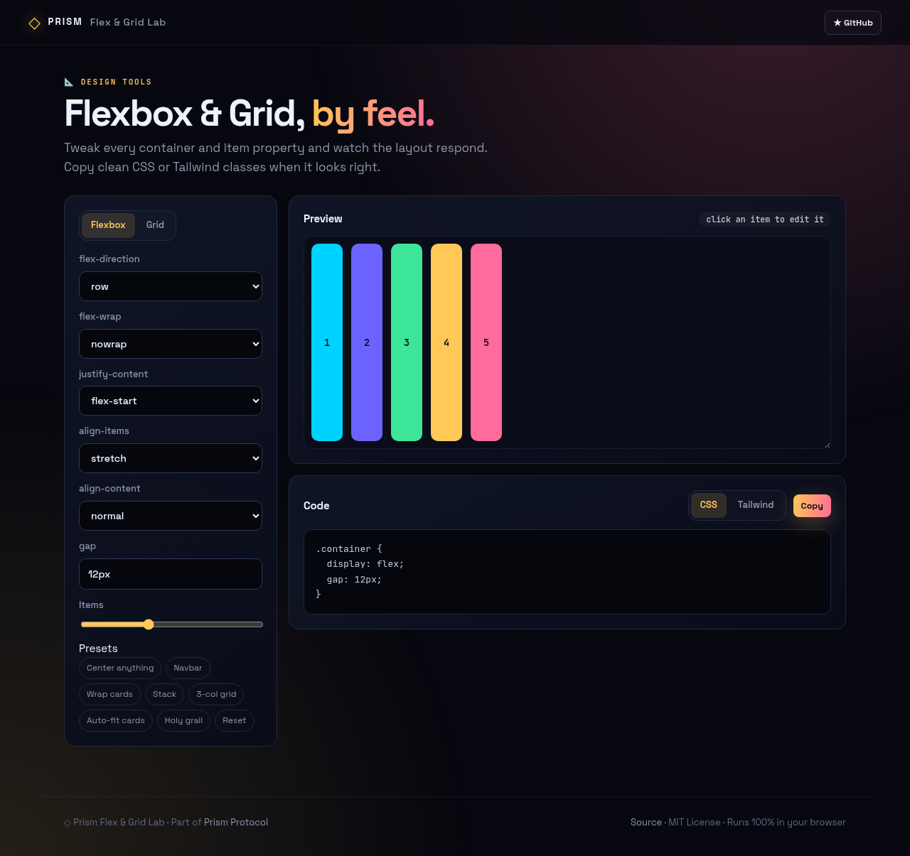
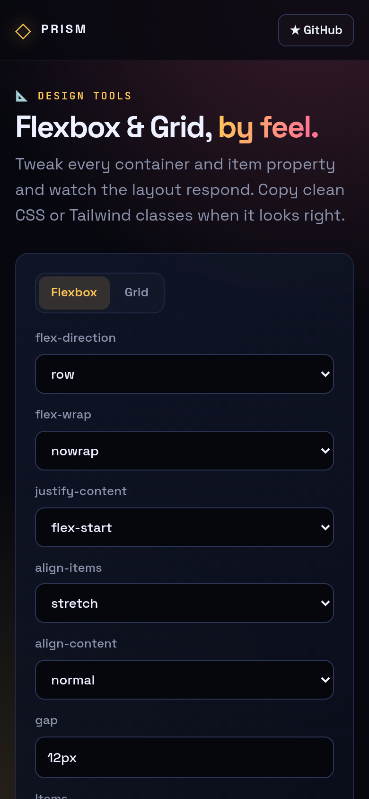

<!-- ═════════════ HEADER ═════════════ -->
<p align="center">
  
</p>

<p align="center">
  
</p>

<p align="center">
  <a href="https://github.com/krishyaa06/prism-flex-grid/actions/workflows/ci.yml"></a>
  <a href="https://krishyaa06.github.io/prism-flex-grid/"></a>
  
  
  <a href="LICENSE"></a>
</p>

<p align="center">
  
</p>


## ⚡ Overview

**Prism Flex & Grid Lab** is a hands-on playground for CSS layout. Switch between Flexbox and Grid, change any container property, click individual items to set grow/shrink/basis/order or grid placement, and resize the stage to test responsiveness. The generated code only contains properties that differ from defaults, and can be exported as Tailwind classes.

## ✨ Features

- **Flexbox + Grid** modes with every common container property
- **Per-item controls** — flex-grow/shrink/basis, order, align-self, grid-column/row
- **Presets**: center anything, navbar, wrap cards, stack, 3-col, auto-fit cards, holy grail
- **Resizable stage** to test wrapping and responsiveness
- **Minimal CSS** output (defaults omitted) and **Tailwind** class export
- State saved locally

## 📸 Screenshots

<table>
  <tr>
    <td width="68%"></td>
    <td width="32%"></td>
  </tr>
</table>

## 🚀 Quick Start

**Use it online:** [https://krishyaa06.github.io/prism-flex-grid/](https://krishyaa06.github.io/prism-flex-grid/)

**Run locally:**

```bash
git clone https://github.com/krishyaa06/prism-flex-grid.git
cd prism-flex-grid
# open index.html in your browser, or serve it:
npx serve .
```

## 🛠️ Usage

1. Choose **Flexbox** or **Grid** and adjust the container controls.
2. Click an item in the preview to edit its own properties.
3. Drag the stage corner to resize; copy the CSS or Tailwind output.

## 📁 Project Structure

```
prism-flex-grid/
├── assets/
│   ├── logo.png
│   └── logo.svg
├── css/
│   ├── app.css
│   └── prism.css
├── js/
│   ├── app.js   # controls and live preview
│   ├── core.js   # CSS / Tailwind generators + presets — tested in Node
│   └── prism.js
├── test/
│   └── core.test.js
├── .gitignore
├── LICENSE
├── index.html
└── package.json
```

## 🧪 Tests

```bash
npm test
```

Tests use the built-in `node:test` runner, so there is nothing to install. CI runs them on Node 20 and 22.

## 🤝 Contributing

1. Fork the repo and create a branch: `git checkout -b feature/my-idea`
2. Make your change and add a test in `test/`
3. Run `npm test` and open a Pull Request

## 🔷 Part of Prism Protocol

Prism Flex & Grid Lab is one of the open-source tools built by [Prism Protocol](https://dc.gg/prismprotocol), a tech community where young builders learn, ship and compete together.

## 👤 Author

<table>
  <tr>
    <td align="center">
      <a href="https://github.com/krishyaa06"><br><b>Soumya Bhandare</b></a><br>
      <sub>Founder @ Prism Protocol</sub>
    </td>
    <td>
      <a href="https://dc.gg/prismprotocol"></a><br>
      <a href="https://instagram.com/prism_protocol_"></a><br>
      <a href="https://x.com/krishyaa06"></a>
    </td>
  </tr>
</table>

## 📄 License

Released under the [MIT License](LICENSE).

<p align="center">
  <b>If you like this project, consider giving it a ⭐</b><br>
  <sub>"Build. Create. Compete." · Made with ⚡ by Prism Protocol</sub>
</p>


